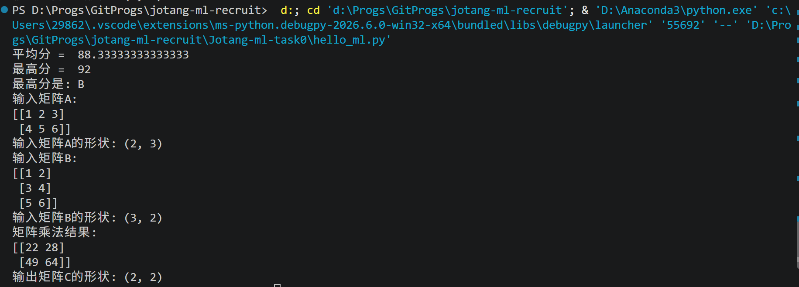

### 1. 人工智能、机器学习与深度学习之间有什么关系？

&emsp;&emsp;人工智能是一个比较大的概念，目标是让计算机具有类似人类的智能能力，例如图像识别、自然语言处理和自动驾驶等。
&emsp;&emsp;而机器学习是实现人工智能的一种方法。与直接由程序员编写所有规则不同，机器学习通过数据让模型自己学习其中的规律，并利用学到的规律进行预测或判断。
&emsp;&emsp;深度学习属于机器学习的一部分，主要利用多层神经网络来学习较复杂的数据特征。

这三者之间的关系我们可以理解为：
`人工智能（AI） > 机器学习（ML） > 深度学习（DL）`

### 2.监督学习和无监督学习有什么区别？请各举一个例子。

&emsp;&emsp;监督学习:模型使用带有标签的数据进行训练，也就是每个输入通常都有对应的正确答案。模型通过这些数据学习输入与标签之间的关系，然后对新的数据进行预测。例如猫狗分类中，训练数据中的图片会提前标注为“猫”或“狗”，模型根据这些带标签的数据学习如何进行分类。
&emsp;&emsp;无监督学习：模型使用没有标签的数据进行训练，这需要模型自己从数据中寻找规律。例如对用户消费数据进行聚类时，我们并不会提前告诉模型每个用户属于哪一类，而是让模型根据数据之间的相似性自动进行分组。
&emsp;&emsp;就好比两个人备考，一个人做题时可以查看标准答案，并通过题目和答案之间的对应关系不断学习，这就是监督学习；而另一个人只有大量题目，没有标准答案，只能自己从题目中寻找相似点和规律，这就是无监督学习。

两者最主要的区别是：`监督学习有标签，无监督学习没有标签`。

### 3. 数据、特征和标签分别是什么？训练集、验证集和测试集各有什么用途？
&emsp;&emsp;`数据`:是模型学习和分析所使用的信息。通常一条数据可以包含多个输入信息，有时也会包含对应的结果。
&emsp;&emsp;`特征`:是模型用来进行判断或预测的**输入**信息，例如在预测学生是否通过考试时，学习时长、平时成绩和出勤率都可以作为特征。
&emsp;&emsp;`标签`:是希望模型最终预测的**结果**，例如“是否通过考试”就是标签。

数据集通常会划分为训练集、验证集和测试集。
- `训练集`用于训练模型，模型会根据训练数据不断调整参数。
- `验证集`用于观察模型训练效果和进行参数选择，例如判断模型是否出现过拟合。
- `测试集`用于在模型训练完成后评价模型最终性能，主要检查模型面对未见过的数据时表现如何。

可以简单理解为：训练集像平时练习，验证集像模拟考试，测试集像最终考试。

### 4.batch size是什么？有什么影响？
&emsp;&emsp;`batch size`：模型每次训练时同时处理的数据数量。例如训练集中有很多数据，如果设置`batch size = 32`，就表示模型每次取32条数据进行计算，计算损失后再进行反向传播和参数更新。（即先预测、计算算错多少、根据误差调整）
&emsp;&emsp;当batch size较小时，占用的显存或内存较少，参数更新会更频繁，但每次计算得到的梯度波动可能更大。
&emsp;&emsp;而当batch size较大时，梯度通常更加稳定，并且在 GPU 上可能具有更高的计算效率，但会占用更多显存。
&emsp;&emsp;因此，batch size需要根据数据规模、硬件条件和模型情况进行选择，并不是越大越好。

### 5.什么是模型和模型参数？
&emsp;&emsp;`模型`：可以理解为一种从输入得到输出的规则或结构。例如输入一张图片，模型可以输出它属于猫还是狗。
&emsp;&emsp;`模型参数`:是模型内部需要通过训练不断调整的数值。
&emsp;&emsp;例如在简单的线性模型 `y = wx + b` 中，`w` 和 `b` 就属于模型参数。训练模型的过程，就是根据预测结果和真实结果之间的误差，不断调整这些参数，使模型的预测更加准确。

可以理解为：`模型决定“怎么计算”，参数决定“具体怎么算”。模型是结构，参数是训练过程中学出来的数值。`。

### 6.神经网络由哪些基本部分组成？什么是激活函数？为什么要激活函数？请介绍几种常见的激活函数。
&emsp;&emsp;神经网络通常由输入层、隐藏层和输出层组成。其中隐藏层中包含多个神经元，每个神经元会对输入进行加权求和、加上偏置，再通过激活函数得到输出。

&emsp;&emsp;`激活函数`:用于给神经网络加入非线性能力。如果没有激活函数，即使神经网络有很多层，整体仍然只能表示比较简单的线性关系，很难学习复杂的数据规律。

常见的激活函数包括：
>**ReLU**：将小于 0 的值变为 0，大于 0 的值保持不变，是深度学习中常用的激活函数。
>**Sigmoid**：将输出限制在 0 到 1 之间，常用于二分类问题。
>**Tanh**：将输出限制在 -1 到 1 之间。
>**Softmax**：常用于多分类任务的输出层，将多个输出转换为各类别的概率。

激活函数让神经网络不只是进行简单的线性计算，而是能够学习更加复杂的关系。

### 7.矩阵相关知识。为什么神经网络中经常会用到矩阵？
&emsp;&emsp;矩阵求导可以理解为：计算矩阵中各个参数发生变化时，会对最终结果产生怎样的影响。
&emsp;&emsp;神经网络中的输入、权重和中间结果通常会使用矩阵表示，因此在训练过程中经常需要对矩阵中的参数求导。矩阵求导可以理解为计算权重矩阵中每个参数发生变化时，对损失函数会产生怎样的影响，从而得到对应的梯度。反向传播会利用这些梯度来更新模型参数。梯度可以告诉模型每个参数应该向哪个方向调整，最终用于更新模型参数。
&emsp;&emsp;因此，矩阵求导是反向传播和参数更新的重要基础。

### 8.怎么用矩阵乘法表示神经网络的全连接层前向传播过程？
&emsp;&emsp;在全连接层中，每个输入都会与下一层的每个神经元连接，因此可以使用矩阵乘法一次完成大量加权计算。
&emsp;&emsp;如果输入记为`X`，权重矩阵记为`W`，偏置记为 `b`，那么全连接层通常可以表示为：`Y = XW + b`。其中，矩阵乘法相当于把多个输入特征按照不同的权重进行组合，从而得到下一层神经元的输出。（全连接层 = 每个输入都参与下一层每个神经元的计算）
&emsp;&emsp;使用矩阵形式不仅表达更加简洁，也方便计算机一次处理多个样本和多个神经元。

### 9.前向传播与反向传播分别在做什么？损失函数、梯度和学习率在训练过程中扮演什么角色？
&emsp;&emsp;`前向传播`是指输入数据从神经网络的输入层开始，经过各层计算，最终得到模型预测结果的过程。
&emsp;&emsp;得到预测结果后，模型会将预测值和真实值进行比较，并通过损失函数计算误差。
&emsp;&emsp;`反向传播`则是根据这个误差，从输出层向前逐层计算各个参数的梯度，从而确定模型参数应该如何调整。

我们可以理解为：

- 前向传播负责得到预测结果；
- 反向传播负责根据预测误差计算参数应该怎样调整。

&emsp;&emsp;`损失函数`：用于衡量模型预测结果和真实结果之间的差距。损失越小，通常说明模型的预测结果越接近真实值。

&emsp;&emsp;`梯度`:表示损失函数相对于模型参数的变化情况，可以帮助确定参数应该向哪个方向调整，才能使损失减小。

&emsp;&emsp;`学习率`:用于控制每次更新模型参数时的调整幅度。如果学习率太大，参数可能调整过头，导致训练不稳定；如果学习率太小，模型训练速度可能会很慢。
>因此
>损失函数：告诉模型错了多少；
>梯度：告诉模型应该往哪个方向改；
>学习率：决定每次改多少。

### 10.优化器是什么？有哪些？
&emsp;&emsp;`优化器`：用于根据梯度更新模型参数。在模型训练过程中，反向传播会计算出各个参数的梯度，优化器再结合学习率和具体的更新规则，对模型参数进行调整，使损失逐渐减小。


>- 优化器负责按照一定规则真正更新参数。

常见的优化器有 SGD、Adam 和 RMSprop。

### 11.什么是过拟合，欠拟合，正则化？
&emsp;&emsp;`欠拟合`：是指模型没有充分学到数据中的规律，因此在训练集和测试集上的表现都比较差。
&emsp;&emsp;`过拟合`:是指模型在训练集上的表现很好，但在新的数据上表现较差。可以理解为模型过度记住了训练数据中的细节，而没有学到具有泛化能力的规律。
&emsp;&emsp;`正则化`:是一类用于减少过拟合的方法，它可以限制模型变得过于复杂，从而提高模型在新数据上的表现。
&emsp;&emsp;常见的正则化方法包括 L1/L2 正则化、Dropout、数据增强和 Early Stopping 等。

### Python运行结果
```bash
python hello_ml.py
```


### 开发环境搭建及相关问题

#### 1.为什么不同项目最好使用不同的 Python 虚拟环境？
&emsp;&emsp;不同项目所需要的 Python 版本、库以及库的版本可能不同，如果所有项目都共用同一个环境，容易出现依赖冲突。
&emsp;&emsp;使用独立的虚拟环境可以让每个项目拥有自己的一套依赖，不同项目之间互不影响，也更方便后续维护和复现项目环境。

#### 2.CPU 和 GPU 各自擅长什么？训练神经网络为什么经常使用 GPU？
&emsp;&emsp;CPU 比较擅长处理逻辑复杂、流程控制较多的任务，单个计算核心的能力较强。
&emsp;&emsp;GPU 拥有大量计算单元，更擅长进行大规模并行计算，特别适合矩阵运算和向量运算。
&emsp;&emsp;在神经网络训练过程中需要进行大量矩阵乘法和数值计算，这些计算可以同时进行，使用 GPU 可以明显提高训练速度，因此 GPU 更被频繁使用。

#### 3.CUDA 是什么？它、显卡驱动与 PyTorch 之间大致是什么关系？
&emsp;&emsp;`CUDA`是 NVIDIA 提供的一套 GPU 计算平台，可以让程序使用 NVIDIA 显卡进行通用计算，而不仅仅用于图形显示。
&emsp;&emsp;`显卡驱动`负责让操作系统正确识别和使用显卡，CUDA 则提供使用 GPU 进行计算的能力。PyTorch 可以调用 CUDA，将张量运算和神经网络训练放到 GPU 上执行，从而提高计算速度。

