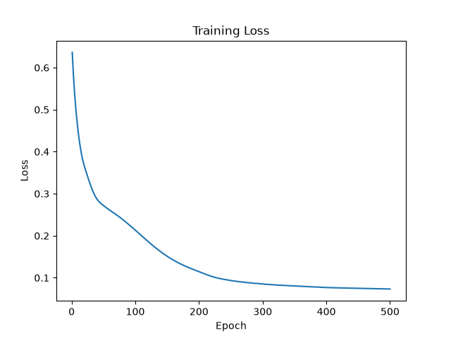
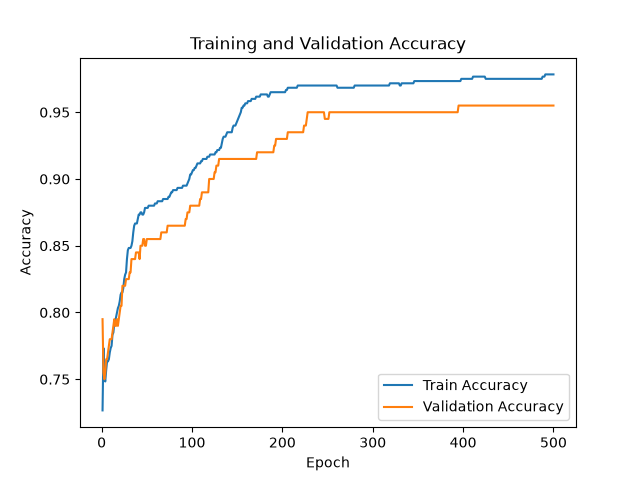
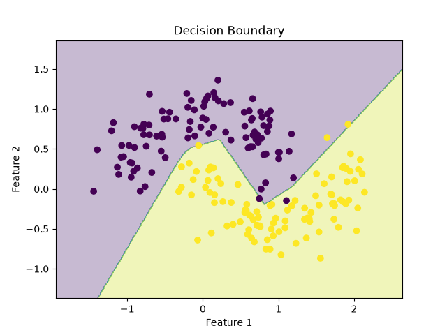
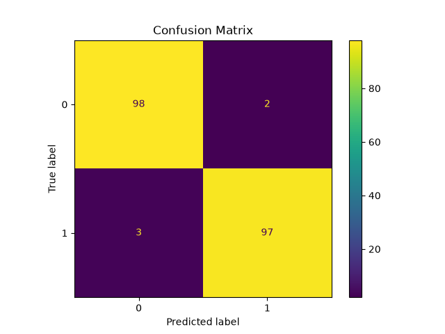
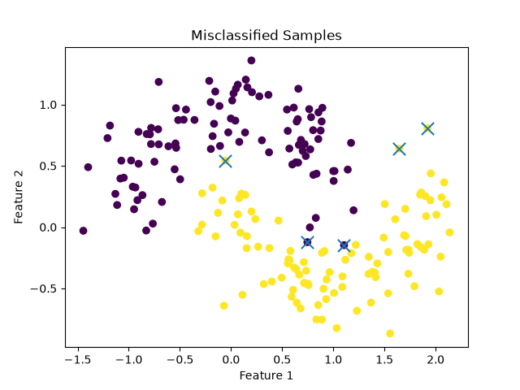

# Task 1：简单神经网络

## 1. 项目简介

本任务使用`scikit-learn`的`make_moons`生成二维二分类数据，并使用 PyTorch 构建一个包含隐藏层的`MLP`完成分类任务。

数据集按照 60% / 20% / 20% 的比例划分为训练集、验证集和测试集，并固定随机种子以保证实验可复现。

## 2. 运行环境

- Python 3.12
- PyTorch
- NumPy
- Matplotlib
- scikit-learn

## 3. 运行方法

在仓库根目录运行：

```bash
python Jotang-ml-task1/main.py
```

## 4. 模型结构

基础模型使用一个隐藏层的 MLP：

```text
输入层：2
↓
隐藏层：16
↓
ReLU
↓
输出层：2
```
损失函数使用 CrossEntropyLoss，优化器使用 Adam。

## 5.实验结果

### 5.1 隐藏层宽度对比
| hidden_size | Final Loss | Train Acc | Val Acc | Test Acc | 错误样本数 |
|:---:|:---:|:---:|:---:|:---:|:---:|
| 8  | 0.0817 | 0.9650 | 0.9550 | 0.9750 | 5 |
| 16 | 0.0733 | 0.9783 | 0.9550 | 0.9750 | 5 |
| 32 | 0.0638 | 0.9800 | 0.9500 | 0.9850 | 3 |

### 5.2 学习率对比
| learning rate | Final Loss | Train Acc | Val Acc | Test Acc | 错误样本数 |
|:---:|:---:|:---:|:---:|:---:|:---:|
| 0.001 | 0.2695 | 0.8783 | 0.8550 | 0.9250 | 15 |
| 0.01  | 0.0733 | 0.9783 | 0.9550 | 0.9750 | 5  |
| 0.1   | 0.0606 | 0.9767 | 0.9650 | 0.9900 | 2  |

### 5.3 Loss/Accuracy曲线

Loss 整体持续下降并逐渐趋于稳定，说明模型训练过程正常。

&emsp;

训练集与验证集准确率整体上升，且差距较小，没有出现明显过拟合。

### 5.4 决策边界

决策边界能够基本将两类数据分开。

### 5.5 混淆矩阵与错分样本



混淆矩阵显示模型大部分样本分类正确，而错分样本主要集中在类别边界附近。