# task 2

## 实践一  卷积核

###  1.了解数字图片如何被表示，并回答：像素是什么？什么是 RGB？灰度图和彩色图有什么区别？
（1）：
**一张数字图片，本质上就是很多数字组成的矩阵。**
`像素`是数字图像中最基本的组成单位，一张图片可以看成由许多像素按照行和列排列形成的矩阵。每个像素保存该位置的颜色或亮度信息。
一张彩色图片中的一个像素通常可以写成`[R,G,B]` (即Red Green Blue)
>eg:&ensp;[0,0,0]黑色      
>&emsp;&emsp;[255,255,255]白色      
>&emsp;&emsp;[255,0,0]红色

这三个通道共同决定了一个像素最终显示什么颜色。

（2）：
灰度图主要表示明暗变化，一个像素通常只需要一个亮度值，因此一般只需要一个数字。
>eg:&ensp; 0 -> 黑色
&emsp;&ensp; 255 -> 白色

区别：
> - RGB 彩色图：每个像素 = 3 个数字
> - 灰度图：每个像素 = 1 个数字

---

### 2.图片
读取图片并转换为 NumPy 数组后得到：

- shape：`(540, 960, 3)`
- dtype：`uint8`
- 最大值：`255`
- 最小值：`16`
- 一个像素的RGB：`[181, 197, 213]`

其中 `540` 表示图片高度，`960` 表示图片宽度，`3` 表示 RGB 三个颜色通道。`uint8` 表示 8 位无符号整数，取值范围为 0~255，因此适合保存普通图片的 RGB 数值。`[181, 197, 213]` 分别表示该像素的 R、G、B 三个通道值。转换为 PyTorch 常见的 CHW 排列后，Tensor shape 为：`torch.Size([3, 540, 960])`

（1）：`HWC`排列：
>H = Height  （图片高多少个像素）
W = Width   （图片宽多少个像素）
C = Channel （通道数量）


（2）HWC 与 CHW有什么区别
CHW：通道优先（如果是一批照片，则是NCHW）
NumPy/Pillow更多的是描述图片的具体细节，如图片的高、宽、每个像素的颜色值，所以常用HWC；
PyTorch更关心“有多少个通道”，所以把通道数放前面,常用CHW。

---

### 3.卷积核
`卷积核`:一个较小的数据矩阵，用于提取图片的局部特征。
`卷积核的移动`：通常从左到右，从上到下移动。stride 表示卷积核每次移动的距离。stride 越大，输出特征图通常越小。eg: stride=1,每次移动1个像素; stride=2,每次移动2个像素。
`计算`：将卷积核和当前图片区域里的对应元素相乘，再把结果相加，作为新的像素值输出。

---

### 4.仅使用 Python 和 NumPy，手写一个能够处理灰度图或 RGB 图片的二维卷积函数。核心卷积过程不能调用 cv2.filter2D、scipy.signal.convolve2d、torch.nn.Conv2d 等现成实现。
见practice1.py

---

### 5.至少使用下面四种卷积核处理同一张图片，把原图和结果放在一起比较：
>均值模糊：使用 3×3 的均值卷积核；
高斯模糊：使用 5×5 的高斯卷积核，可以查阅高斯函数并自行生成或填写卷积核；
锐化：例如使用 [[0,-1,0],[-1,5,-1],[0,-1,0]]；
边缘检测：使用 Sobel-X 和 Sobel-Y，尝试把两个方向的结果合成为一张边缘图。

均值模糊：
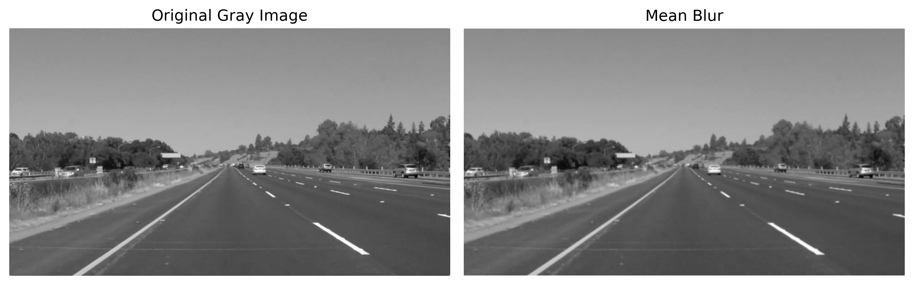

高斯模糊：
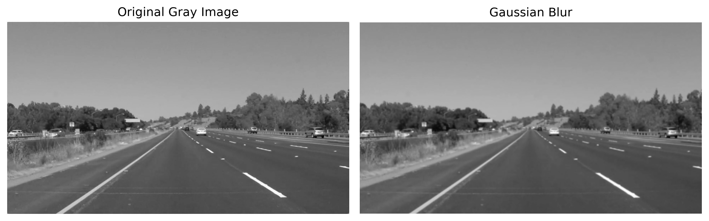

锐化：
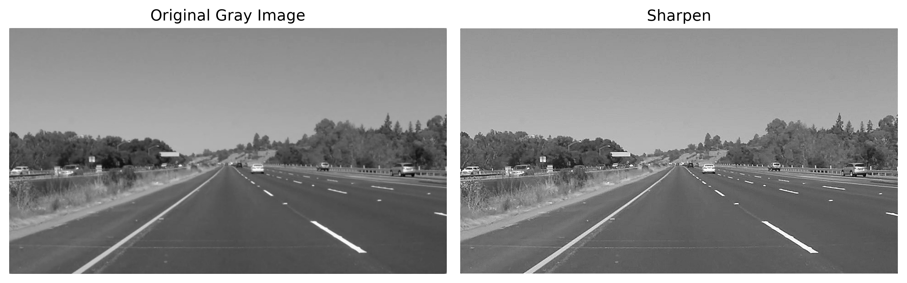

边缘检测：
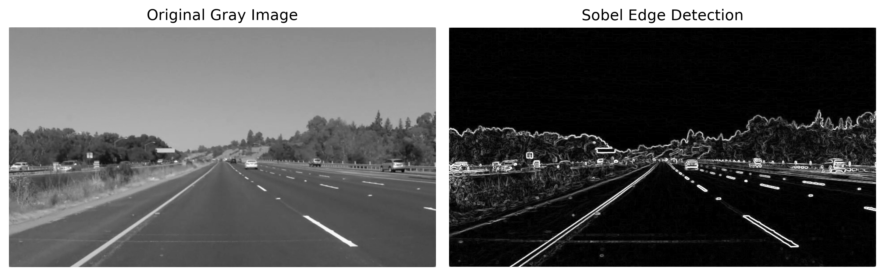

---

### 6.观察并解释每种处理带来的变化：为什么均值与高斯卷积会让图片变模糊？为什么锐化会让边缘更明显？Sobel 卷积核为什么能找到边缘？
（1）：因为均值与高斯卷积都会用周围多个像素的平均或加权平均结果代替当前像素。这样会减小相邻像素之间的差异，使细节和边缘变得不明显，因此图片看起来更模糊。
（2）：因为锐化卷积核会增强中心像素和周围像素之间的差异。在平坦区域中，相邻像素差异很小，因此变化不明显；而在边缘区域中，相邻像素变化很大，因此会被进一步增强。
（3）：边缘实际上就是像素值变化比较剧烈的位置。Sobel卷积核通过比较相邻区域的亮度变化，能够找出变化较大的位置，因此可以检测图像中的边缘。

---

### 7.分别尝试不填充（valid）和适当填充（same）图片边缘，比较输出尺寸与边缘像素的变化。记录卷积核大小、padding、stride 与输出尺寸之间的关系。（图像卷积完成后，部分结果可能小于 0 或大于原来的像素范围。保存图片以前想一想应该怎样处理这些数值。）
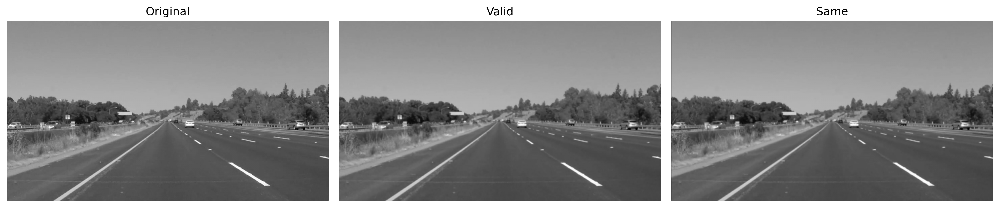
本实验原灰度图尺寸为 (540, 960)，使用3×3卷积核，stride=1。
当 padding=0 时：(540, 960) -> (538, 958)因为图像边缘没有进行填充，卷积核只能在能够完整覆盖图像的位置进行计算，所以输出尺寸变小。
当 padding=1 时：(540, 960) -> (540, 960),对于 3×3 卷积核、stride=1，在上下左右各补 1 个像素后，可以使输出尺寸与原图相同，因此得到same效果。
卷积输出尺寸的计算公式为：output = (input + 2 × padding - kernel_size) // stride + 1

valid 不进行边缘填充，因此原图最外侧的一部分像素不会作为卷积中心参与输出。

本实验的 same 使用0进行 padding，因此虽然能够保持图像尺寸不变，但边缘位置在卷积时会与人为补入的0一起计算，因此边缘像素可能与图像内部像素产生不同的变化。

因为卷积之后部分结果可能小于0或大于255。为了将结果作为普通uint8图像显示和保存，本实验使用：np.clip(result, 0, 255)将小于0的值限制为0，大于255的值限制为255。

---

## 实践二：训练猫狗分类器

### 问题
1.统计数据集的时候要选择所需文件类型，不能默认文件夹里面的所有内容都是自己所需的。（比如猫狗分类训练集里面有一个非图片文件，就要把它剔除后再统计图片数量）

2.随机数据增强 = 训练时随机改变图片外观，但保持类别不变，从而让模型学得更稳、更能泛化。（一般只用于训练集，不直接用于验证集和测试集）

---

### 1.数据集观察
通过统计可得：

- 小猫图片：12500张
- 小狗图片：12500张

随机抽取部分图片后可发现，数据集中不同图片的尺寸并不统一。同时，图片清晰度、拍摄角度、背景和主体大小也存在明显差异。
因此，在送入CNN训练之前，我们需要对图片进行统一的预处理。

---

### 2. 猫狗图片数据读取、预处理与 Batch

#### （1）数据读取
本实验通过文件名进行标签划分：

- `cat.xxx.jpg` → Cat → 标签 0
- `dog.xxx.jpg` → Dog → 标签 1

图片统一转换为 RGB 三通道图像。

数据集按照以下比例划分：

- 训练集：15000 张，占 60%
- 验证集：5000 张，占 20%
- 测试集：5000 张，占 20%

同时使用`stratify`保证三个数据集中猫和狗的比例基本一致。

训练时使用Batch方式输入数据，设置：`batch_size = 16`，因此模型每次接收 16 张图片。

一个Batch的Tensor形状为：`[16, 3, 128, 128]`

>- 16：一个 Batch 中的图片数量
>- 3：RGB 三个通道
>- 128：图片高度
>- 128：图片宽度

训练集设置`shuffle=True`，使每个epoch中图片顺序被重新打乱；验证集和测试集设置`shuffle=False`。

#### （2）预处理以及前后对比
**一：**
验证集和测试集只进行固定预处理：
- Resize 为 128×128
-  转换为 PyTorch Tensor

训练集另外设计了数据增强：

-  Resize 为 144×144
-  RandomCrop 随机裁剪为 128×128
-  RandomHorizontalFlip 以 0.5 的概率进行水平翻转
-  转换为 Tensor

随机数据增强可以让模型在训练过程中看到同一张图片的不同形式，从而减少模型对固定位置、固定背景等特征的依赖，提高模型对新图片的适应能力。

验证集和测试集不使用随机增强，因为它们主要用于稳定地评价模型性能。如果每次评价时图片都随机变化，会使评价结果产生额外波动。

**二：**
为了检查图像预处理过程中是否出现拉伸、裁剪错误或颜色异常，我随机选取了一张原始图片，将预处理前后的结果进行对比。
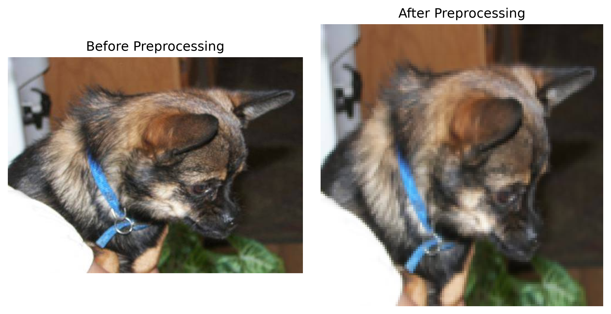

通过观察可以发现，预处理后的图片颜色显示正常，没有出现明显的颜色异常。
由于使用了`Resize((128,128))`，将不同长宽比的原始图片统一缩放为正方形，因此部分图片会出现一定程度的拉伸或压缩。从对比图中可以看到，处理后的动物外形相较原图存在一定形变。

---

### 3. CNN 模型结构

本实验使用 PyTorch 搭建了一个简单的卷积神经网络 CNN。

整体结构为：
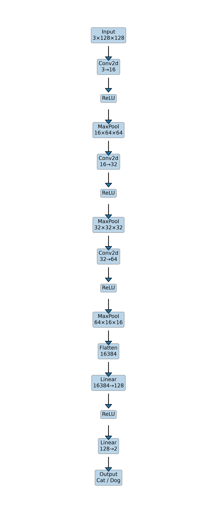

`卷积层`主要负责提取图像特征，ReLU用于增加网络的非线性表达能力。

随着网络逐层计算，特征图的宽和高逐渐减小，而通道数量逐渐增加。
**宽高减小可以降低计算量，并逐渐压缩空间信息；通道数量增加则能够让网络学习更多种类的特征。**

`池化层`：把一小块区域的信息压缩成一个更小的表示。
作用：
>- 减小特征图尺寸，让后面计算更快；
>- 保留比较明显的特征，比如边缘、纹理响应比较强的位置；
>- 让模型对小范围的位置变化没那么敏感。比如猫耳朵稍微往左一点或右一点，模型仍可能抓住“这里有一个强特征”。

最大池化层:用于压缩特征图尺寸，同时保留较明显的特征。强调“这一小块里最明显的特征有没有出现”。

对比卷积层：卷积层负责找特征，池化层负责压缩特征，同时尽量保留最明显的信息。

---

### 4. CNN 各层 Tensor 形状

选取一张图片输入 CNN 后，各层 Tensor 形状如下：

输入：

`[1, 3, 128, 128]`

第一组：

- Conv2d → `[1, 16, 128, 128]`
- ReLU → `[1, 16, 128, 128]`
- MaxPool2d → `[1, 16, 64, 64]`

第二组：

- Conv2d → `[1, 32, 64, 64]`
- ReLU → `[1, 32, 64, 64]`
- MaxPool2d → `[1, 32, 32, 32]`

第三组：

- Conv2d → `[1, 64, 32, 32]`
- ReLU → `[1, 64, 32, 32]`
- MaxPool2d → `[1, 64, 16, 16]`

分类器：

- Flatten → `[1, 16384]`
- Linear → `[1, 128]`
- ReLU → `[1, 128]`
- Linear → `[1, 2]`

可以看到：

- 卷积层主要改变通道数量；
- ReLU 不改变 Tensor 形状；
- MaxPool2d 会使宽和高减半；
- Flatten 将多维特征图展开成一维向量；
- 最后一层输出两个值，分别对应 Cat 和 Dog 两个类别。

---

### 5. 特征图可视化

本次实验中，分别对第一层卷积输出和最后一层卷积输出进行了可视化。

第一层卷积输出形状为：

`[1, 16, 128, 128]`

第一层特征图仍然保留较多原始图片的结构信息，不同通道对亮度、边缘、纹理等信息产生不同响应。如下图所示：
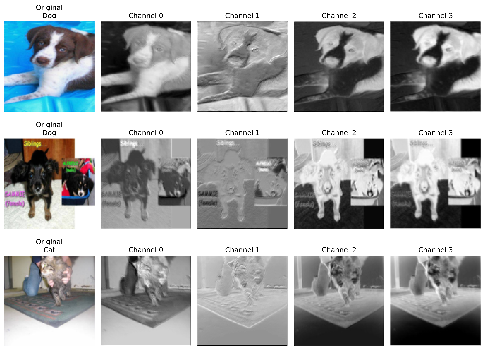

&emsp;
最后一层卷积输出形状为：

`[1, 64, 32, 32]`

相比第一层，最后一层的特征图已经更加抽象，不再像原始图片，而是表现为不同位置的亮暗响应区域。部分通道响应较强，部分通道接近全黑，说明不同通道关注的图像特征并不相同。如图所示：
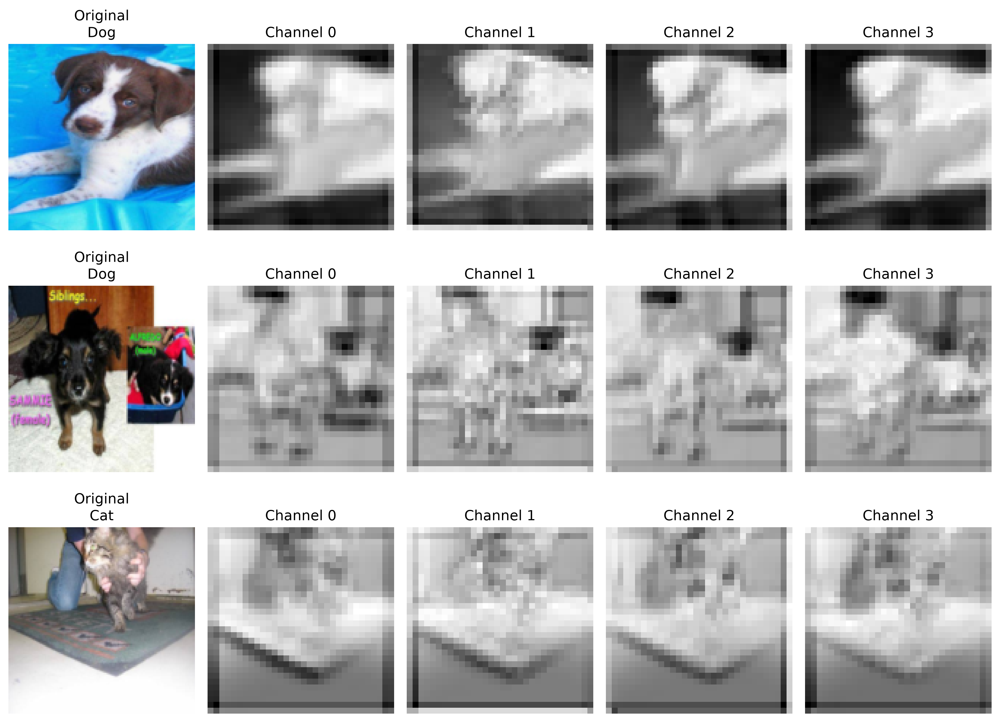

&emsp;
由上可知，浅层卷积通常更关注边缘、颜色和简单纹理，而深层卷积会在这些低级特征的基础上进一步组合出更加抽象、更加有利于分类的特征。

---

### 6. 数据增强对照实验

为了观察数据增强对模型分类性能的影响，我进行了“有数据增强”和“无数据增强”的对照实验。

实验中保持以下条件一致：

- CNN 网络结构相同
- 数据集划分相同
- Batch Size 相同
- 学习率相同
- 优化器相同
- Epoch 数量相同
- 验证集和测试集相同

唯一主要变量为训练集是否使用随机数据增强。

训练集使用的数据增强包括：

- Resize 为 144×144
- RandomCrop 随机裁剪为 128×128
- RandomHorizontalFlip，以 0.5 概率进行水平翻转

对同一张图片多次进行随机数据增强后，可以看到不同增强结果在裁剪位置和动物朝向上存在一定变化，但动物主体总体仍然能够保留。

随机水平翻转不会改变猫或狗本身的类别，因此属于比较合理的数据增强方式。

适度随机裁剪能够减少模型对动物固定位置的依赖，但如果裁剪范围过大，可能将动物主体的重要部分裁掉，从而影响训练效果。

数据增强后图片的变化如下：
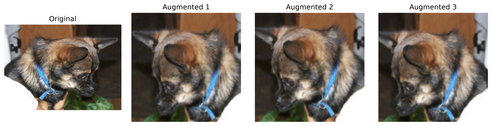

实验结果如下：

| 实验 | 第3轮 Train Acc | 第3轮 Val Acc | Test Acc |
|---|:---:|:---:|:---:|
| 有数据增强 | 0.7269 | 0.7240 | 0.7340 |
| 无数据增强 | 0.7444 | 0.7214 | 0.7286 |

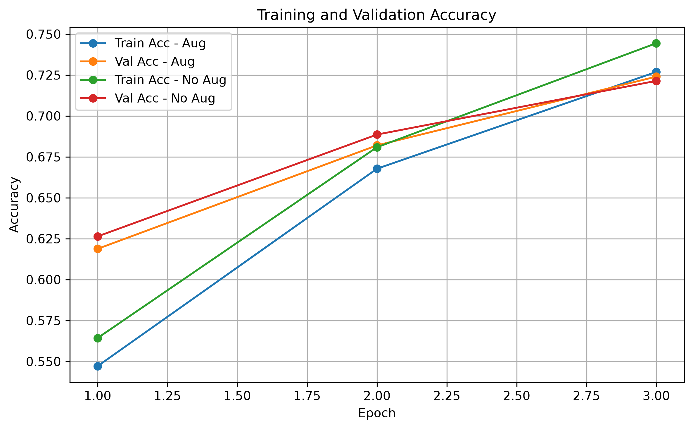

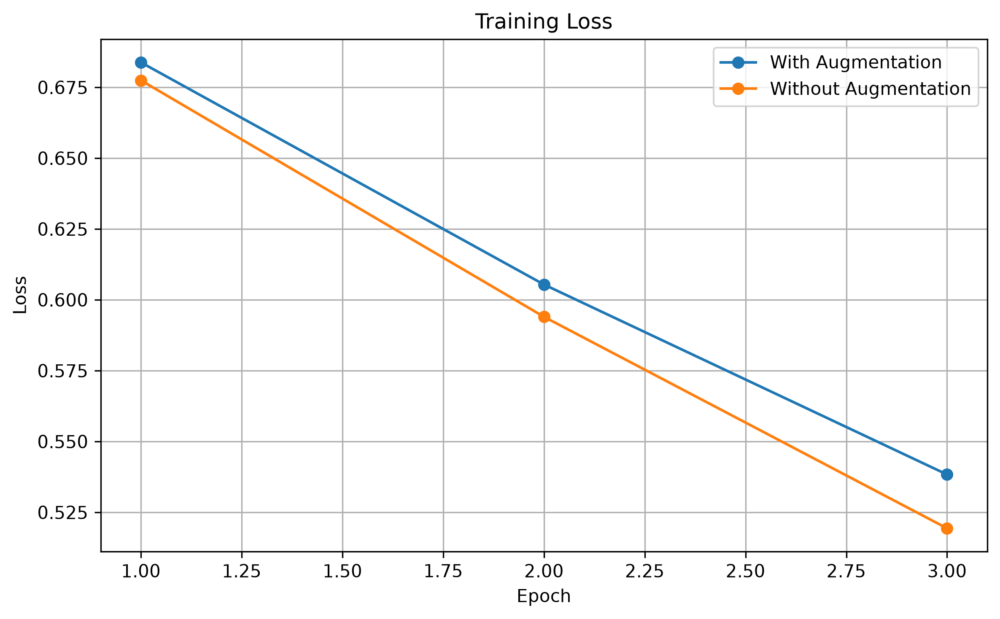

从表格和曲线我们可以看出，无数据增强模型的训练准确率更高，但有数据增强模型在验证集和测试集上的表现略好。
两组模型的训练Loss都随着Epoch增加而持续下降，说明模型在训练过程中逐渐学习到有效特征。无数据增强模型的Loss略低于有数据增强模型，说明其对固定训练数据拟合得更快。

我认为造成这种现象可能有以下几点原因：
1.**无增强模型**看到的训练图片比较固定，因此更容易拟合训练集；而**有增强模型**训练时会随机裁剪和翻转图片，增加了训练难度，因此训练准确率略低；但是数据增强让模型在训练过程中接触到更多不同形式的图片，因此在未见过的数据上具有稍好的泛化能力。

在本实验中，有数据增强模型的测试准确率由0.7286提升到0.7340，说明适当的数据增强对模型泛化能力有一定帮助。

---

### 7. 错误样本分析

最终我们选择验证集表现更好的有增强模型进行后续分析。

该模型测试集准确率为：0.7340

测试集共有 5000 张图片，其中错误分类：1330张

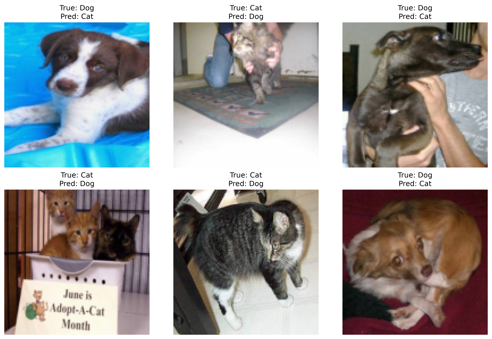

观察上面的部分错误样本后可以发现，预测错误主要集中在以下情况：

1. 图片比较模糊，动物局部特征不明显；
2. 动物主体较小，背景占据较大区域；
3. 拍摄角度比较特殊；
4. 动物身体受到遮挡，只能看到部分区域；
5. 一张图片中同时出现多个动物；
6. 动物姿态比较特殊；
7. 部分猫狗的脸型、毛色或局部外观比较相似。

例如，部分狗的脸比较圆、耳朵较短，在模糊图片中可能与模型学习到的猫的局部特征比较接近；而一些猫的主体较小或者背景复杂，也容易被误判为狗。

这些错误说明当前简单 CNN 已经能够学习一定的猫狗特征，但面对复杂背景、特殊姿态和低质量图片时，泛化能力仍然有限。

可能的改进方法包括：

- 使用更多样的数据增强；
- 增加训练轮数；
- 适当增加网络深度；
- 使用更丰富的训练数据；
- 提高输入图片分辨率；
- 使用更强的 CNN 网络结构。

本实验已经尝试加入随机裁剪和随机水平翻转，测试准确率从 0.7286 提升到 0.7340，这说明数据增强能够带来一定改进。

---

### 8. 模型保存与独立推理

训练过程中根据验证集Accuracy保存当前表现最好的模型。

另外编写了独立推理程序：`inference.py`

推理程序可以完成以下过程：

本地图片  
&emsp;&emsp;↓  
读取为 RGB 图片  
&emsp;&emsp;↓  
Resize 为 128×128  
&emsp;&emsp;↓  
转换为 Tensor  
&emsp;&emsp;↓  
输入 CNN  
&emsp;&emsp;↓  
使用 Softmax 将模型输出转换为分类概率  
&emsp;&emsp;↓  
输出 Cat / Dog 以及预测概率  
&emsp;&emsp;↓  
显示处理后的图片

&emsp;&emsp;
在测试一张猫的图片时，模型输出结果为：
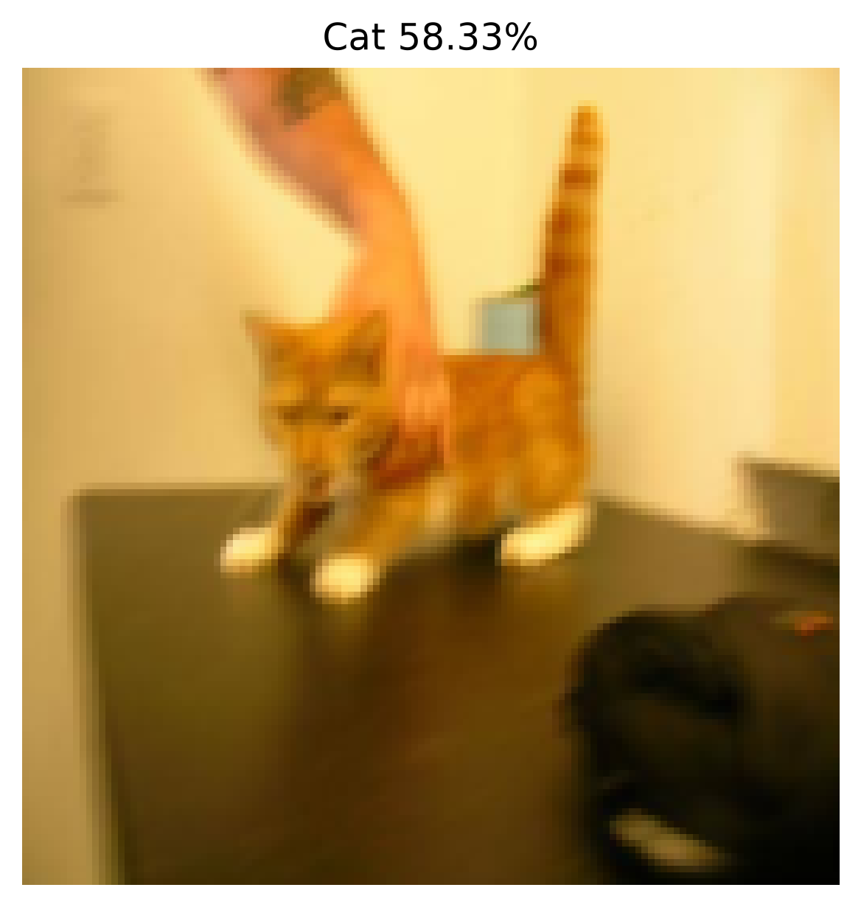

说明独立推理程序能够正常读取本地图片并完成猫狗分类。

推理阶段没有使用随机裁剪和随机翻转，而是使用与验证集和测试集一致的固定预处理，以保证同一张图片能够得到稳定的预测结果。

---

### 9. 模型结构图

根据搭建的`SimpleCNN`绘制了模型结构图。

结构图展示了：

- 输入图片尺寸；
- 三个卷积层；
- ReLU 激活函数；
- 三个最大池化层；
- 通道数变化；
- 特征图尺寸变化；
- Flatten；
- 两个全连接层；
- Cat / Dog 两分类输出。

通过结构图可以更加直观地看到 CNN 从原始 RGB 图片逐步提取特征并最终完成分类的过程。

---

## 趁热打铁
### 1.卷积层为什么比直接使用一个巨大的全连接层更适合处理图片？试着用全连接层试试看实现本任务？对比一下差距
图像通常包含大量像素，如果直接把整张图片展开后输入全连接网络，会产生非常多的参数，计算量和存储开销都比较大，也更容易出现过拟合。
卷积神经网络利用卷积核在图像上滑动，同一个卷积核参数可以在不同位置重复使用，因此参数共享程度更高，能够明显减少参数数量。同时，卷积操作只关注局部区域，可以先提取边缘、纹理等局部特征，再通过多层卷积逐渐组合成更加复杂的特征，更符合图像的空间结构特点。
因此，相比直接使用大型全连接网络，CNN 在处理图像时通常具有参数更少、计算更高效、能够保留空间信息和更适合提取局部特征等优点。
例如：本实验输入图片大小为 3×128×128，如果直接展平，则输入维度为49152。如果直接连接到一个128个神经元的全连接层，仅这一层就需要约 49152×128 个权重参数。而CNN通过多个小尺寸卷积核逐层提取特征，可以大幅减少参数规模。

---

### 2.卷积层的输入通道和输出通道分别表示什么？它们与卷积核的数量有什么关系？
`输入通道`表示卷积层接收到的特征图数量。
`输出通道`表示卷积层最终生成的特征图数量。
例如本实验第一层卷积为: Conv2d(3, 16, kernel_size=3, padding=1)，其中输入通道数为3，因为输入的是RGB图片，分别对应 R、G、B 三个通道；输出通道数为16，表示这一层会生成16张新的特征图。
在PyTorch中，一个输出通道对应一组卷积核参数。由于每个输出通道都需要同时处理所有输入通道，因此第一层实际上可以理解为有16组卷积核，每组卷积核都包含3个 3×3 的小卷积核，分别作用于 R、G、B 三个输入通道。
所以，**输出通道数和卷积核组数相对应。输出通道越多，网络就能够学习更多种不同的特征。**

---

### 3.padding、stride 和 pooling 会怎样改变特征图的尺寸？请结合自己网络中的一层实际计算。
卷积层输出特征图的尺寸主要受到输入尺寸、卷积核大小、Padding 和 Stride 的影响。

当输入尺寸为 $H \times W$，卷积核大小为 $K$，Padding 为 $P$，Stride 为 $S$ 时，输出特征图的高度可以表示为：

$$
H_{out}
=
\left\lfloor
\frac{H+2P-K}{S}
\right\rfloor
+1
$$

宽度的计算方式相同。

其中：

- **Padding**：在输入图像边缘补充像素，可以减小卷积后尺寸的损失；
- **Stride**：表示卷积核每次移动的步长，Stride 越大，输出特征图尺寸通常越小；
- **Pooling**：用于进一步压缩特征图尺寸，减少计算量，同时保留较明显的特征。

结合本实验第一层卷积：
```python
nn.Conv2d(
    3,
    16,
    kernel_size=3,
    padding=1
)
```
输入图片尺寸为：3 × 128 × 128
K = 3   
P = 1
S = 1
H = 128
所以经过公式计算得： $$ H_{out} = 128 $$
由此可得卷积后的特征图宽高仍然为：128 × 128
由于该卷积层的输出通道数为 16，所以第一层卷积的完整输出形状为：16 × 128 × 128
随后经过：`nn.MaxPool2d(kernel_size=2)`
最大池化层默认 stride=2，因此宽和高都会缩小为原来的一半：
```
128 × 128
    ↓
64 × 64
```
所以本实验第一组网络的尺寸变化为：
```
3 × 128 × 128
   ↓ Conv2d
16 × 128 × 128
   ↓ MaxPool2d
16 × 64 × 64
```

由此可以看出，本实验第一层卷积由于使用了padding=1、stride=1，因此卷积前后宽高保持不变；而最大池化层将宽和高压缩为原来的一半。

---

### 4.随着网络逐层计算，特征图的宽和高通常越来越小，通道数却可能越来越多，这是为什么？
在卷积神经网络中，随着网络逐层加深，特征图的宽和高通常会逐渐减小，而通道数往往会逐渐增加。

在本实验中尺寸变化如下：
```
输入：
3 × 128 × 128
    ↓ 第一组卷积与池化
16 × 64 × 64
    ↓ 第二组卷积与池化
32 × 32 × 32
    ↓ 第三组卷积与池化
64 × 16 × 16
```
我们可以看到：
- 特征图的宽和高由 128 × 128 逐渐减小到 16 × 16；
- 通道数由 3 逐渐增加到 64。
  
**减少特征图的宽和高，主要有以下原因：**
**1. 减少计算量**
   特征图尺寸越大，后续卷积运算需要处理的数据越多。通过池化等操作逐渐缩小宽和高，可以减少后续网络的计算量，提高计算效率。
**2. 压缩空间信息**
   网络前面的层通常需要保留较多图像的具体位置信息，而随着网络加深，模型更关心“图片中出现了什么特征”，而不是这些特征具体位于哪个像素位置。
**3. 逐渐提取更加抽象的特征**
   浅层网络通常学习边缘、颜色、简单纹理等低级特征。
   随着网络加深，这些简单特征会进一步组合，例如形成动物的耳朵、眼睛、脸部轮廓等更加复杂的特征，因此不再需要保留原始图片那么高的空间分辨率。

**通道数增加:** 是因为网络需要学习越来越多种不同的特征。每个通道可以理解为一种特征响应，因此增加通道数能够让网络同时表示更多不同类型的图像特征。

>**宽和高逐渐减小，是为了压缩空间信息、减少计算量；通道数逐渐增加，是为了保存和学习更多种类、更抽象的特征。**

---

### 5.你选择了什么激活函数和损失函数？它们为什么适合这道二分类题？
本实验选择的激活函数是`ReLU`，损失函数是`CrossEntropyLoss`。

`ReLU`可以为网络加入非线性，使CNN能够学习更复杂的图像特征，而且其计算简单，适合卷积神经网络，因此适合作为本实验隐藏层的激活函数。

本实验最后一层为：nn.Linear(128, 2),它会输出两个值，分别对应 Cat 和 Dog 两个类别。
而`CrossEntropyLoss`适合这种“输出两个类别分数”的分类方式，其可以直接根据模型输出和真实标签计算分类误差。因此训练时使用：nn.CrossEntropyLoss()

所以，本实验中：
>隐藏层：ReLU
输出层：Linear(128, 2)
损失函数：CrossEntropyLoss

这三者能够很好地配合完成猫狗二分类任务。

在推理阶段，为了把模型输出转换成直观的预测概率，再使用：`torch.softmax(output, dim=1)`,最终可以得到类似：`Cat 58.33%`这样的预测结果。
因此，本实验选择` ReLU `作为隐藏层激活函数是为了增强网络的非线性特征学习能力，选择` CrossEntropyLoss `作为损失函数是因为它与当前“两个类别输出”的网络结构相匹配，适合完成 Cat / Dog 二分类任务

---

### 6.为什么训练集上的随机数据增强不应该原样用在验证集和测试集上？翻转、裁剪和颜色变化分别可能带来什么帮助或问题？
训练集使用随机数据增强，是为了让模型在训练过程中看到更多不同形式的图片，从而减少模型对固定位置、固定背景和固定外观的依赖，提高模型的泛化能力。
但是验证集和测试集的作用是稳定、客观地评价模型性能。如果验证集和测试集也使用随机增强，那么同一张图片每次评价时都可能发生变化，导致评价结果产生额外波动，不利于公平比较不同模型。
因此训练集上的随机数据增强不应该原样用在验证集和测试集上。

不同数据增强方式的影响如下：
- 随机水平翻转：通常不会改变猫或狗本身的类别，可以让模型减少对动物朝向的依赖。
- 随机裁剪：可以让模型减少对动物固定位置的依赖，但如果裁剪过度，可能把动物主体或关键特征裁掉，从而影响训练效果。
- 颜色变换：适度改变亮度、对比度或颜色，可以增强模型对不同光照条件的适应能力；但如果变化过大，可能导致图片颜色严重失真，反而影响模型学习正常特征。